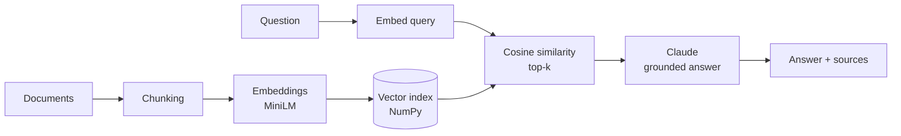

# Simple RAG

A minimal, readable Retrieval-Augmented Generation pipeline in ~100 lines of Python.
Ask questions about your own documents (`.md`, `.txt`, `.pdf`) and get answers with cited sources.



## Features
- Local embeddings (`all-MiniLM-L6-v2`), no embedding API costs
- Overlapping word-based chunking
- Cosine-similarity retrieval over a NumPy index (no vector DB needed)
- Grounded answers with inline citations via the Anthropic API
- Works without an API key too: shows retrieved chunks only

## Quickstart

```bash
git clone https://github.com/<your-username>/simple-rag.git
cd simple-rag
python -m venv .venv && source .venv/bin/activate   # Windows: .venv\Scripts\activate
pip install -r requirements.txt

cp .env.example .env        # add your ANTHROPIC_API_KEY (optional)

python ingest.py            # build the index from ./data
python chat.py              # start asking questions
```

Drop your own files into `data/` and re-run `python ingest.py`.

## Example

```
You: Why use RAG?
Answer: RAG reduces hallucinations by grounding answers in real documents [1], and lets you
use private or up-to-date data without retraining [1].
Sources:
  [1] sample.md (score 0.71): Retrieval-Augmented Generation (RAG) combines ...
```

## Project structure

| File | Purpose |
|------|---------|
| `rag.py` | Loading, chunking, embedding, retrieval, generation |
| `ingest.py` | Builds the index from `data/` |
| `chat.py` | Interactive CLI |
| `data/` | Your documents |

## Design decisions
- **NumPy instead of a vector DB:** at small scale, a matrix multiply is fast and keeps the code easy to read. Swap in FAISS or Chroma when the corpus grows.
- **Normalized embeddings:** cosine similarity becomes a simple dot product.
- **Strict system prompt:** the model must answer only from context and say "I don't know" otherwise.

## Roadmap
- [ ] Streamlit / Gradio web UI
- [ ] Hybrid search (BM25 + vectors) and re-ranking
- [ ] Evaluation set with retrieval hit-rate and answer faithfulness
- [ ] Swap NumPy for FAISS or Chroma

## License
MIT
