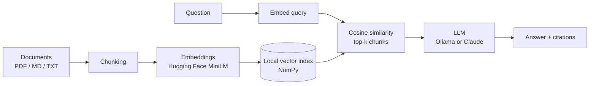

# Offline Doc-RAG: Chat With Your Documents, Fully Offline

> A lightweight Retrieval-Augmented Generation (RAG) pipeline that answers questions about your own documents and cites its sources.
> Runs 100% locally with Ollama and Hugging Face embeddings, or switch to Claude with a single setting.

  

## Overview

I built this project from scratch to understand how RAG works end to end. It loads PDFs, Markdown and text files, splits them into overlapping chunks, embeds them locally with a Hugging Face model, and retrieves the most relevant chunks with cosine similarity. A local LLM served by Ollama (`llama3.2`) then writes an answer grounded in those chunks, with inline citations like `[1]`. After testing with sample questions, I tuned the chunk size to improve retrieval quality, and I added streaming output and configurable model providers.

**Architecture in short:** documents are chunked and embedded once into a local index; at question time the query is embedded, the top matching chunks are retrieved, and the LLM answers using only those chunks.



## Core Components

| Component | Technology | Role |
|-----------|-----------|------|
| Loader | `pypdf`, plain file reading | Reads `.pdf`, `.md` and `.txt` files from `data/` |
| Chunker | Custom word-based splitter | Splits text into ~100-word chunks with 20-word overlap |
| Embedder | Hugging Face `sentence-transformers` (`all-MiniLM-L6-v2`) | Turns text into normalized vectors, locally and for free |
| Vector index | NumPy (`embeddings.npy` + `chunks.json`) | Stores vectors; search is a single matrix multiply |
| Retriever | Cosine similarity, top-k (default 4) | Finds the chunks most relevant to the question |
| Generator | **Ollama** (`llama3.2`) or Anthropic Claude | Writes a grounded answer with citations |
| Interface | CLI with streaming output | Interactive Q&A with sources and similarity scores |

## Key Design Principles

- **Local-first and private:** documents and questions never leave your machine when using Ollama.
- **Grounded answers:** the model must answer only from retrieved context, cite sources, and say "I don't know" otherwise.
- **Simple and readable:** about 100 lines of core logic and no vector database, so every step is easy to follow.
- **Swappable providers:** switch between Ollama and Claude by changing one environment variable.
- **Transparent retrieval:** every answer shows the source chunks and similarity scores, so you can debug quality.
- **Responsive:** the embedding model preloads at startup and answers stream token by token.

## Tech Stack

- **Language:** Python 3.10+
- **Embeddings:** Hugging Face `sentence-transformers` (`all-MiniLM-L6-v2`)
- **LLM serving:** Ollama (`llama3.2`), optional Anthropic API
- **Vector search:** NumPy
- **Parsing and config:** `pypdf`, `python-dotenv`

## Getting Started

### Prerequisites

- Python 3.10 or newer
- [Ollama](https://ollama.com/download) installed

### 1. Clone and install

```bash
git clone https://github.com/hassaanhameed786/offline-doc-rag.git
cd offline-doc-rag
python -m venv .venv
```

Activate the virtual environment:

```bash
# macOS / Linux
source .venv/bin/activate

# Windows PowerShell
.\.venv\Scripts\Activate.ps1
```

Install dependencies:

```bash
pip install -r requirements.txt
```

### 2. Configure environment variables

```bash
cp .env.example .env          # Windows: Copy-Item .env.example .env
```

| Variable | Default | Description |
|----------|---------|-------------|
| `LLM_PROVIDER` | `ollama` | `ollama` (local) or `anthropic` (cloud) |
| `OLLAMA_MODEL` | `llama3.2` | Any model you have pulled in Ollama |
| `ANTHROPIC_API_KEY` | none | Only needed when `LLM_PROVIDER=anthropic` |
| `LLM_MODEL` | `claude-sonnet-5-5` | Claude model to use when `LLM_PROVIDER=anthropic` |
| `HF_HUB_OFFLINE` | unset | Set to `1` after the first run to skip the Hugging Face update check and start faster |

### 3. Start Ollama locally

```bash
ollama pull llama3.2
ollama serve        # skip if Ollama is already running in the background
```

### 4. Index your documents and chat

Put your `.md`, `.txt` or `.pdf` files in the `data/` folder, then:

```bash
python ingest.py    # builds the local index (re-run whenever documents change)
python chat.py      # starts the interactive Q&A
```

The first run downloads the embedding model (about 90 MB). After that everything works offline.

## Usage

```
Using ollama (llama3.2)
Ask a question (type 'exit' to quit)

You: What was Google's original search engine called?

Answer: According to [1], Google's original search engine was nicknamed "BackRub".

Sources:
  [1] google_overview.md (score 0.66): # Google: A Company Overview ## Origins Google began as a research project at Stanford...
  [2] google_overview.md (score 0.59): that received links from many important pages were ranked higher...
```

### Where you can use it

- **Personal knowledge base:** ask questions across your notes, papers and study material.
- **Resume or portfolio Q&A:** let people query a set of resumes or project write-ups.
- **Internal documentation search:** policies, handbooks, onboarding guides, runbooks.
- **Customer support:** answer from FAQs and product manuals with traceable sources.
- **Sensitive documents:** contracts, medical or financial files that cannot be sent to a third-party API.

### Real-world impact

- Saves time by replacing manual searching with direct, cited answers.
- Reduces hallucinations because answers are tied to your own documents.
- Keeps private data on your own machine, with no per-token API cost.
- Citations make every answer easy to verify.

## Project Structure

```
offline-doc-rag/
├── data/               # Your documents (.md, .txt, .pdf)
├── index/              # Generated vector index (git-ignored)
├── rag.py              # Core pipeline: load, chunk, embed, retrieve, generate
├── ingest.py           # Builds the index from data/
├── chat.py             # Interactive CLI with streaming answers
├── requirements.txt
├── .env.example        # Environment variable template
├── .gitignore
├── LICENSE
└── README.md
```

## How It Works

This project is a command-line tool, so it has no HTTP endpoints yet (see Future Work). Its entry points are:

| Entry point | What it does |
|-------------|--------------|
| `python ingest.py` | Loads documents, chunks them, embeds them and saves the index |
| `python chat.py` | Loads the index and answers questions in an interactive loop |
| `build_index()` / `Retriever.search()` / `stream_answer()` | The Python functions in `rag.py` that you can import into your own app |

**How RAG works here, step by step:**

1. **Index (once):** documents are split into overlapping chunks, and each chunk is converted into a vector that captures its meaning.
2. **Retrieve (per question):** the question is embedded the same way, and the closest chunks are found by cosine similarity.
3. **Generate:** the question and retrieved chunks go to the LLM with instructions to answer only from that context and cite sources.
4. **Respond:** the answer streams back along with the source chunks and scores.

**What RAG gives you:** an LLM that can answer from your private or up-to-date documents without retraining, with fewer hallucinations and verifiable sources.

**A note on agents:** this is a single-pass RAG pipeline, not an agent. It retrieves once and answers once. An agentic version, where the model decides when to search, rewrites queries and retrieves in multiple steps, is listed under Future Work.

## Future Work

- [ ] FastAPI service with `/ingest` and `/ask` endpoints
- [ ] Web UI with Streamlit or Gradio
- [ ] Evaluation script that reports retrieval hit rate and answer faithfulness
- [ ] Heading-aware and paragraph-aware chunking
- [ ] Hybrid search (BM25 plus vectors) and re-ranking
- [ ] Swap NumPy for FAISS or Chroma for larger collections
- [ ] Conversation memory for follow-up questions
- [ ] Agentic RAG with query rewriting and multi-step retrieval
- [ ] Optional embeddings through Ollama (`nomic-embed-text`)

## License

This project is licensed under the MIT License. See the [LICENSE](LICENSE) file for details.

---

Built by **[Your Name]**, [one-line description of yourself, e.g. "an aspiring AI engineer exploring practical, privacy-first LLM applications"].
